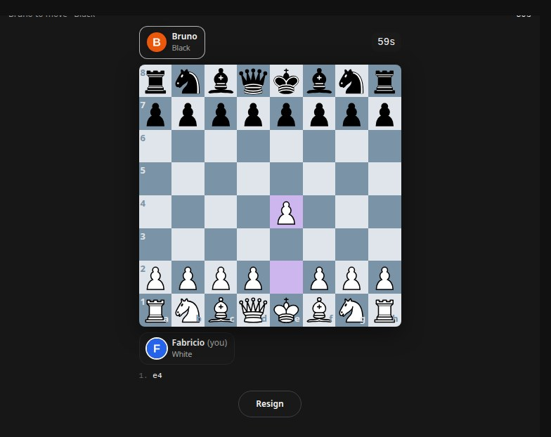
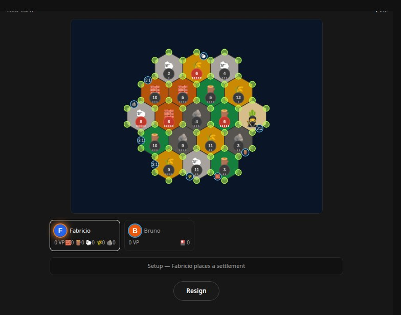
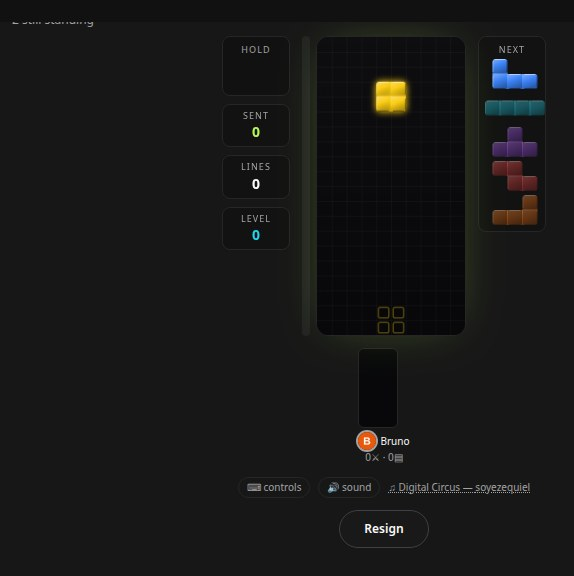
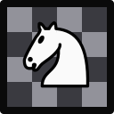
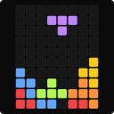
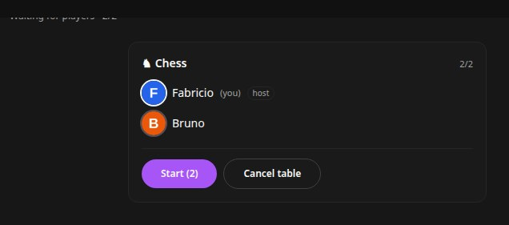

<div align="center">



<p>
  <a href="https://github.com/obelisk-app/obelisk-apps/stargazers"></a>
  <a href="https://github.com/obelisk-app/obelisk-apps/commits/main"></a>
  
</p>
<p>
  
  
  
  
  
  
  
  
</p>

<h3>
  <a href="https://obelisk.ar">🗿 Play on Obelisk</a>
  &nbsp;·&nbsp;
  <a href="#the-idea-in-one-paragraph">💡 The idea</a>
  &nbsp;·&nbsp;
  <a href="docs/app-format.md">📜 App format</a>
  &nbsp;·&nbsp;
  <a href="#build-test-publish">🛠️ Build &amp; publish</a>
</h3>

</div>

# Obelisk Apps

Games and small apps for [Obelisk](https://github.com/obelisk-app/obelisk), shipped as Nostr events instead of as client code.

**Status: live on test.obelisk.ar.** The SDK, the shared UI shell, the frame loader, the Blossom sidecar and four games are built and published: Chain Reaction, Vesta and Stacker (moved from obelisk-dex) and Chess (new, on chess.js + react-chessboard). The `games.obelisk.ar` dashboard comes next. See [docs/known-issues.md](docs/known-issues.md).

## 🎲 The games

<div align="center">

<br><sub>An 18-move game on the 5×7 board, played by the rules in <a href="apps/chain-reaction/src/engine.ts"><code>engine.ts</code></a>. Every move is one kind 2390 event.</sub>
</div>

<table>
<tr>
<td width="33%"></td>
<td width="33%"></td>
<td width="33%"></td>
</tr>
<tr>
<td valign="top"> <b>Chess</b><br>Two players, full rules, every move replayed by every client. Built on chess.js and react-chessboard.</td>
<td valign="top"> <b>Vesta</b><br>Settle, trade and build on a hex island.</td>
<td valign="top"> <b>Stacker</b><br>Real-time falling-block battles: clears send garbage lines to the others, and every attack can be replayed and checked.</td>
</tr>
</table>

<details>
<summary><b>🪑 The lobby every game shares</b></summary>
<br>
<div align="center"></div>

`packages/ui` is the shared shell: the lobby card, a board that fits, readable buttons and the players' pictures on every board. Screenshots are from `scripts/frame-harness.mjs`, which runs each bundle in real Chromium inside the real frame.
</details>

## 🔁 From `git push` to a game in the chat

<div align="center">

</div>

## The idea in one paragraph

Publishing an app works like this:

1. An author uploads a bundle (one ES module, plus any assets) to Blossom.
2. The author signs one **app manifest** event (kind `32390`) on a relay.

Anyone who can write to that relay can publish an app. The relay's existing write gate is the curation.

obelisk-dex doesn't ship game code. On the relay the user is browsing, it:

- lists the manifests;
- verifies the bundle against the sha256 in the manifest;
- runs it in a sandboxed, network-less iframe.

The app never touches the user's keys. It asks the host to publish kind `2390` session events, and the host builds and signs them under strict rules. Every client replays the same session log through the same pinned bundle, so no referee is needed. This is the trust model obelisk-dex games already use.

## Layout (planned)

```
docs/                 the wire format, host API, security model, known issues
packages/sdk/         @obelisk/apps-sdk: host RPC client, turn-based and realtime kits, test harness
packages/frame/       the sandbox loader page (served from its own origin)
apps/chain-reaction/  first-party apps, moved from obelisk-dex
apps/vesta/
apps/stacker/
apps/chess/           chess.js rules, react-chessboard UI
dashboard/            games.obelisk.ar: publish, browse, try apps (admin-shell design)
```

## Build, test, publish

```bash
npm install
npm test                                   # every package and app
cd apps/chess && npm run build             # dist/index.js + assets + manifest draft
node scripts/frame-harness.mjs apps/chess --stage board --click e2,e4   # real Chromium, real frame
node scripts/publish-app.mjs apps/chess --nsec-file <file> --relay wss://public.obelisk.ar
```

## Docs

| Doc | What it covers |
|---|---|
| [app-format.md](docs/app-format.md) | Kind 32390 manifest, kind 2390 session events, chat marker, versioning |
| [host-api.md](docs/host-api.md) | The postMessage contract between obelisk-dex and an app frame |
| [security.md](docs/security.md) | Trust boundary, threat model, sandbox and CSP, what is deliberately not exposed |
| [known-issues.md](docs/known-issues.md) | Open bugs, security gaps and decisions still pending |

Cross-project policy lives in [obelisk-design/security-workflows/app-sandbox.md](https://github.com/obelisk-app/obelisk-design/blob/main/security-workflows/app-sandbox.md). The host side lives in obelisk-dex (`docs/apps.md`, once the migration lands).

## 🌐 Around it

| | |
|---|---|
| 🗿 [**obelisk**](https://github.com/obelisk-app/obelisk) | The client (obelisk-dex) that lists, verifies and hosts the apps. Live at [obelisk.ar](https://obelisk.ar). |
| 🏝️ [**obelisk-sky**](https://github.com/obelisk-app/obelisk-sky) | The 3D village; its tables follow the same kind 2390 session events. |
| 🌸 [**blossom-server**](https://github.com/obelisk-app/blossom-server) | Our fork of hzrd149's Blossom server behind `blossom.obelisk.ar`, with WoT allowlists (`packages/blossom-wot`) and sandboxed blobs. |
| 📡 [**obelisk-relay**](https://github.com/obelisk-app/obelisk-relay) | The NIP-29 relay whose write gate is the curation, and whose WoT ladder decides who may upload. |
| 🎨 [**obelisk-design**](https://github.com/obelisk-app/obelisk-design) | Cross-project policy, including the app sandbox. |

<div align="center">
<br>
<a href="https://star-history.com/#obelisk-app/obelisk-apps&Date">
  <picture>
    <source media="(prefers-color-scheme: dark)" srcset="https://api.star-history.com/svg?repos=obelisk-app/obelisk-apps&type=Date&theme=dark">
    
  </picture>
</a>
</div>
